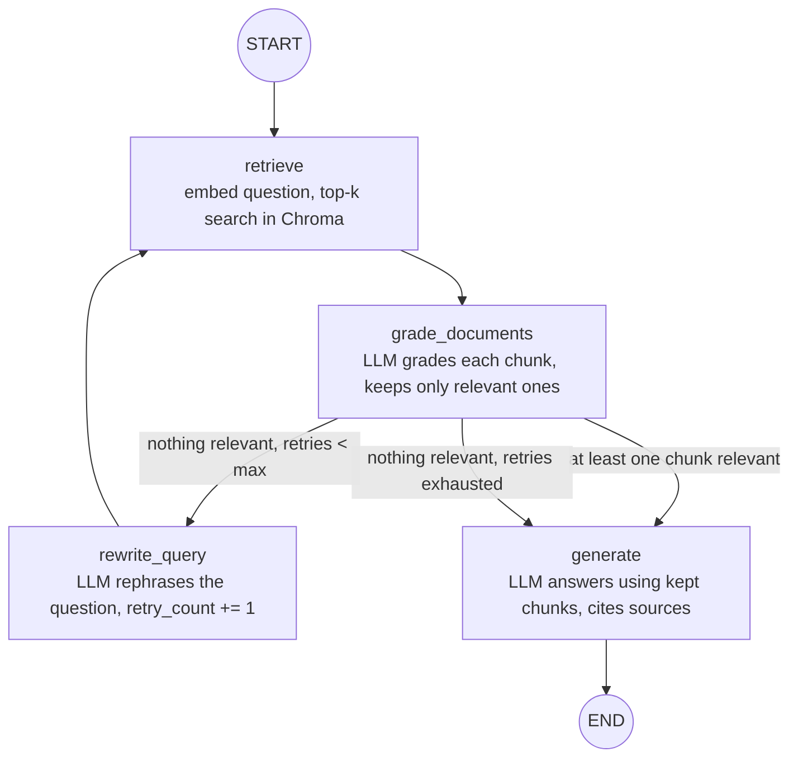
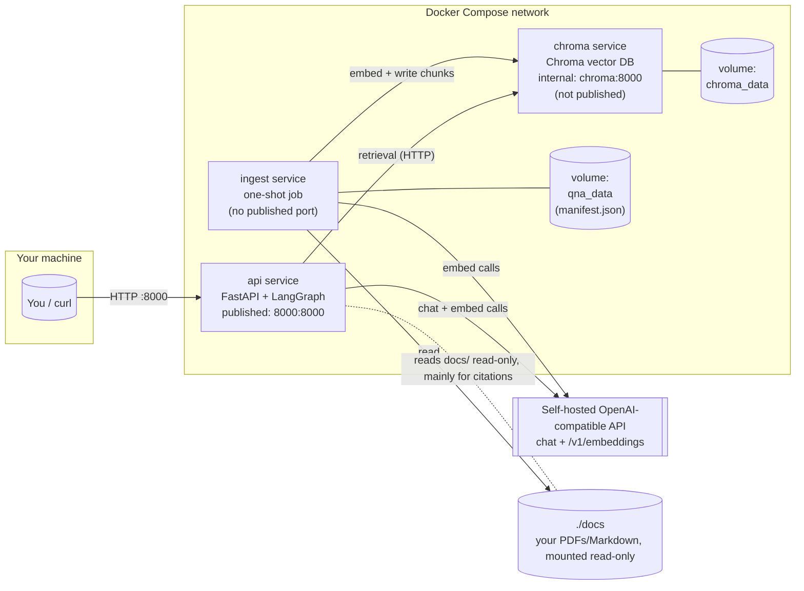

# QnA — Corrective RAG with LangGraph

A Document Q&A system that answers questions over your own PDFs/Markdown files, built as a learning project for [LangGraph](https://langchain-ai.github.io/langgraph/).

It implements the **Corrective RAG** pattern: retrieve documents, have the LLM grade each one's relevance individually, and if nothing relevant came back, rewrite the question and retry (up to a configurable number of times) before answering — rather than blindly generating an answer from whatever got retrieved.

## How it works



- **retrieve** — embeds the question and pulls the top-k most similar chunks from Chroma.
- **grade_documents** — asks the LLM to grade *each retrieved chunk individually* (relevant/not + a one-line reason), and drops the ones graded irrelevant before `generate` ever sees them. The reasoning for every chunk is recorded in `trace`.
- **rewrite_query** — if nothing survived grading and retries remain, asks the LLM to rephrase the question for a better retrieval pass, then loops back to `retrieve`.
- **generate** — answers using the surviving chunks, citing sources (filename + page/heading). If retries were exhausted with nothing relevant, the answer is prefixed with a low-confidence disclaimer.

The graph is defined in [src/qna/graph.py](src/qna/graph.py), which is also the most heavily commented file in the project if you want to learn how LangGraph's `StateGraph`, nodes, and conditional edges fit together. A diagram of the compiled graph is also regenerated automatically on every run and saved to `graph.png`.

## Architecture



- **chroma** — standalone vector database server. Not published to the host; only `api`/`ingest` can reach it, over the internal Compose network at `chroma:8000`.
- **api** — the FastAPI service running the LangGraph graph. Published on `8000:8000`. Talks to `chroma` for retrieval and to your LLM API for chat completions and query embeddings.
- **ingest** — a one-shot job (not a long-running service) that loads `docs/`, splits/embeds new or changed files, and writes them into `chroma`. Also owns the `qna_data` volume holding `manifest.json` (ingestion's incremental-tracking state) — `api` never touches this volume.
- **chroma_data** / **qna_data** — named Docker volumes. `chroma_data` is Chroma's own storage (survives container restarts); `qna_data` is the ingestion manifest. If these two ever drift apart (e.g. one gets wiped independently of the other), ingestion will think files are already embedded when the vector store is actually empty — see the troubleshooting note below.

**Inside `api`**, a request flows through:
- **Ingestion** ([src/qna/ingest.py](src/qna/ingest.py)): incremental and idempotent. A local manifest (`manifest.json`) tracks each file's content hash and the chunk IDs it produced, so re-running ingestion only re-embeds files that are new or changed, and cleans up chunks for files that were deleted. Chunks are embedded in configurable batches (`EMBED_BATCH_SIZE`) rather than one call per file. Safe to interrupt and re-run at any point.
- **Resilience** ([src/qna/resilience.py](src/qna/resilience.py), [src/qna/llm.py](src/qna/llm.py)): every chat and embedding call is retried with exponential backoff (3 attempts) on transient failures (connection errors, timeouts, 5xx) — but fails immediately on permanent errors (bad API key, bad request), raising a clear `LLMError`/`EmbeddingError` instead of a raw stack trace.
- **API** ([src/qna/api.py](src/qna/api.py)): exposes `POST /ask` and `GET /health`. `/ask`'s response includes the full `trace` (what each graph node did, including the grader's per-chunk reasoning) alongside the answer.
- **CLI** ([src/qna/main.py](src/qna/main.py)): `uv run python -m qna.main "question"` for quick one-off questions, printing the same trace.

## Setup

1. Copy the env template and fill in your LLM credentials:
   ```bash
   cp .env.example .env
   ```
2. Drop your PDF/Markdown files into `docs/`.

### Run with Docker Compose (recommended)

```bash
# Start Chroma and the API
docker compose up --build -d chroma api

# Ingest your documents (re-run this any time docs/ changes)
docker compose run --rm ingest

# Ask a question
curl -X POST http://localhost:8000/ask \
  -H "Content-Type: application/json" \
  -d '{"question": "What is the OSI model?"}'
```

The response includes `answer`, `sources`, `confident`, `retries`, and `trace` — `trace` shows exactly what each graph node did, including the grader's reasoning for every retrieved chunk:

```json
{
  "answer": "...",
  "sources": ["OSI_Model_Notes.pdf p.3"],
  "confident": true,
  "retries": 0,
  "trace": [
    "retrieve: found 4 chunk(s)",
    "grade_documents: chunk 0 (OSI_Model_Notes.pdf p.3) relevant=True: \"Defines the Presentation Layer directly.\"",
    "grade_documents: chunk 1 (OSI_Model_Notes.pdf p.1) relevant=False: \"Discusses the Application Layer, not relevant here.\"",
    "generate: answer produced"
  ]
}
```

- Health check: `curl http://localhost:8000/health`
- Interactive API docs: http://localhost:8000/docs
- Stop everything: `docker compose down` (add `-v` to also wipe the Chroma/manifest volumes)

> **Volume drift gotcha:** if the Chroma volume ever gets reset independently of the ingestion manifest (e.g. after `docker compose down -v` on just one service, or restoring from a partial backup), the manifest will think files are already ingested and skip them, leaving the collection empty — `retrieve` will silently return 0 chunks for everything. Run `docker compose run --rm ingest uv run python -m qna.ingest --rebuild` to force a full re-embed from scratch and resync the two.
>
> **Rebuilt code but still seeing old behavior?** `api` and `ingest` are built from the same `Dockerfile` but Compose caches their images separately. Changing source and running `docker compose run ingest` without `--build` (or `docker compose build ingest` first) will silently run the *old* image. Rebuild both explicitly: `docker compose up --build -d api` and `docker compose build ingest`.

### Run locally without Docker

Chroma always runs as a standalone server, so start one first:

```bash
docker run -p 8001:8000 -v chroma_data:/chroma/chroma chromadb/chroma
```

Then, from the project root:

```bash
uv run python -m qna.ingest              # ingest docs/
uv run python -m qna.main "your question"  # CLI
uv run uvicorn qna.api:app --reload        # API on localhost:8000
```

## Configuration

All settings are centralized in [src/qna/config.py](src/qna/config.py) and read from `.env`. See [.env.example](.env.example) for the full list, including:

| Setting | Default | Purpose |
|---|---|---|
| `CHUNK_SIZE` / `CHUNK_OVERLAP` | `1000` / `200` | Text splitting during ingestion |
| `MAX_RETRIES` | `2` | How many rewrite-and-retry passes before answering low-confidence |
| `TOP_K` | `4` | Chunks retrieved per pass |
| `EMBED_BATCH_SIZE` | `32` | Chunks per embeddings API call during ingestion |
| `EMBED_CONCURRENCY` | `1` | Reserved for future parallel-batch tuning (sequential today) |
| `LOG_LEVEL` | `INFO` | Server-side structured logging verbosity |

## Project status

This project is built incrementally, version by version — see the plan history for details. Implemented so far:

- Core self-correcting retrieve/grade/rewrite/generate loop, with per-chunk relevance grading (not just a single yes/no over everything retrieved)
- Incremental, idempotent ingestion with crash recovery and batched embedding calls
- FastAPI service layer with structured logging, centralized config, input validation, and a full reasoning `trace` in every response
- Resilience: retry/backoff with timeouts on all LLM/embedding calls, distinguishing transient failures (retried) from permanent ones (fail fast)
- Docker Compose setup with a standalone Chroma server

Planned next: tests, API-key auth, async conversion + streaming (`/ask/stream`), ruff/mypy/CI, and first public release polish.
